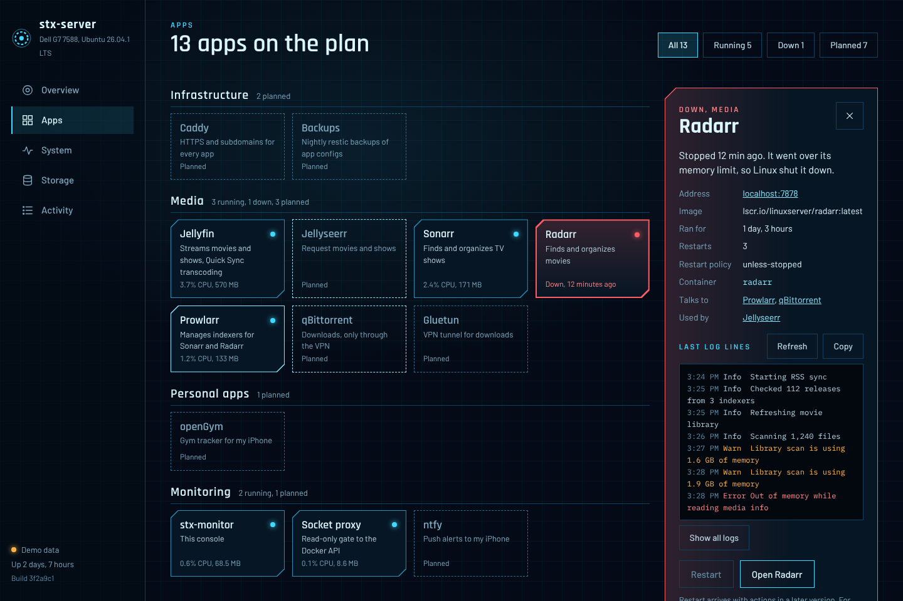

# stx-monitor

The home screen for `stx-server`, my Dell G7 laptop running Ubuntu Server. It shows the
live health of the machine and a map of every app on it, including the ones that are only
planned so far. It is read-only: it watches, it never changes anything.





*Screenshots use demo mode (`/?demo`), which fills the UI with made-up data.*

## What it shows

- **Overview**: CPU, memory and heat as rings around the number of apps running, an alert
  card when something is down, and 1-hour sparklines.
- **Apps**: every app from [`config/apps.yaml`](config/apps.yaml), matched to its container.
  Planned apps have dashed borders. Open one for status, links, and its latest logs.
- **System**: per-thread load, top processes, battery and charge limit, lid, both GPUs
  (is the GTX 1060 asleep?), every temperature and fan, network traffic, Tailscale devices.
- **Storage**: each physical drive, mounted or not, with setup steps for unformatted ones.
- **Activity**: container starts, stops and crashes, power loss, heat and full-disk warnings.

## Set up on stx-server

```bash
git clone https://github.com/isaacxj/stx-monitor.git ~/stx-monitor
```

```bash
~/stx-monitor/scripts/deploy.sh
```

`deploy.sh` pulls the latest code and runs `docker compose up -d --build`. Run it again
whenever you want to update.

ufw (the firewall) blocks port 8090 until you open it. Allow it over Tailscale:

```bash
sudo ufw allow in on tailscale0 to any port 8090 proto tcp
```

And from the home network, if you want it there too (adjust the subnet to yours):

```bash
sudo ufw allow from 192.168.1.0/24 to any port 8090 proto tcp
```

Then open `http://stx-server:8090`. For HTTPS with a real certificate on your tailnet:

```bash
sudo tailscale serve --bg 8090
```

That serves it at `https://stx-server.<your-tailnet>.ts.net`.

## Add an app to the map

Either add it to [`config/apps.yaml`](config/apps.yaml) (the map reloads within seconds,
no restart needed), or label the container in its compose file:

```yaml
labels:
  stx.app: radarr              # matches an id in apps.yaml
  # or, for something not in apps.yaml:
  stx.name: Portainer
  stx.group: infrastructure    # a group id from apps.yaml
  stx.url: https://stx-server:9443
```

An app is matched to a container by the `stx.app` label, then the container name, then the
compose service name. Running containers that match nothing appear under
"Running, not on the plan".

## How it works

Two containers, defined in [`compose.yaml`](compose.yaml):

- **stx-monitor**: Python 3.13, FastAPI and psutil. Serves the API and the web UI on 8090.
- **stx-docker-proxy**: [docker-socket-proxy](https://github.com/Tecnativa/docker-socket-proxy),
  which forwards only the read-only Docker API calls stx-monitor needs.

Linux exposes almost everything about the machine as small text files: `/proc` for
processes, memory and network counters, `/sys` for devices, sensors, batteries and GPUs.
The host's whole filesystem is mounted read-only at `/host`, and every reading comes from
`/host/proc` and `/host/sys`. A few settings make that work:

| Setting | Why |
| --- | --- |
| `network_mode: host` | The container shares the server's network, so ufw filters port 8090 like any other service (Docker's published ports skip ufw) and the real network cards are visible. |
| `pid: host` | The container sees every process on the server, not only its own. |
| `/:/host:ro,rslave` | Read-only view of the host. `rslave` passes drives mounted later on the host into the container. Docker hides `/sys/devices/virtual/powercap` inside containers, so power readings come from `/host/sys`. |
| runs as root | Reading the CPU energy counter (RAPL) and the host's `/proc/1/net` needs root. The mount is read-only and the API has no write endpoints. |

Power is the CPU package draw from RAPL while on wall power, and the whole-system draw from
the battery when unplugged. The UI says which one it is showing. Monthly cost assumes
$0.15/kWh (`STX_POWER_RATE`).

History is kept in memory (1 hour at 3-second resolution, 24 hours of 1-minute averages);
the 24-hour part is saved to the `stx-data` volume every 5 minutes.

## Security

- Read-only API: only `GET` endpoints, nothing that starts, stops or changes anything.
- The host filesystem is mounted read-only.
- stx-monitor never touches `/var/run/docker.sock`. The socket proxy allows containers,
  info and events, refuses every `POST`, and listens on `127.0.0.1` only.
- Not meant for the public internet: keep 8090 limited to Tailscale and your LAN with ufw.
  Anyone who can open the page can read container logs.

## Local development

```bash
python3 -m venv .venv && . .venv/bin/activate
pip install -r requirements-dev.txt
pytest
```

```bash
STX_HOST_ROOT=/ DOCKER_HOST=none python -m monitor
```

Then open `http://localhost:8090`, or `http://localhost:8090/?demo` for fake data. Point
`DOCKER_HOST` at `unix:///var/run/docker.sock` or the proxy to see real containers.

Settings, all from environment variables: `STX_HOST_ROOT`, `DOCKER_HOST` (or `none`),
`STX_APPS_FILE`, `STX_DATA_DIR`, `STX_BIND`, `STX_PORT` (8090), `STX_POWER_RATE` (0.15),
`STX_GIT_SHA`, `STX_OWNER` (the name in the greeting).

## Roadmap

- Restart, stop and update buttons, through a narrowly scoped proxy, with an audit log.
- Power-outage autopilot: on battery below a set charge, stop containers and shut down cleanly.
- ntfy push alerts to my iPhone.
- Image update watcher.
- Jellyfin now playing, with a hardware vs software transcode badge.
- Sonarr/Radarr download queue and a hardlink check.
- Disk-full forecast from the growth rate.
- SMART disk health.
- Backup age.
- "Ask Claude" diagnosis button for a failing container.
- Deploy panel showing the running commit for each app.
