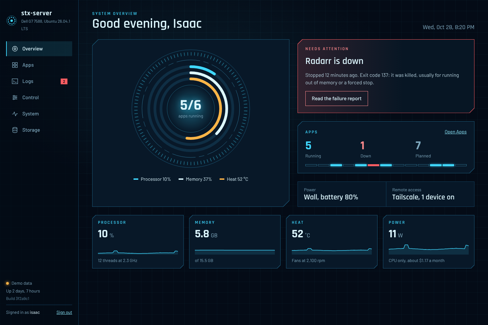
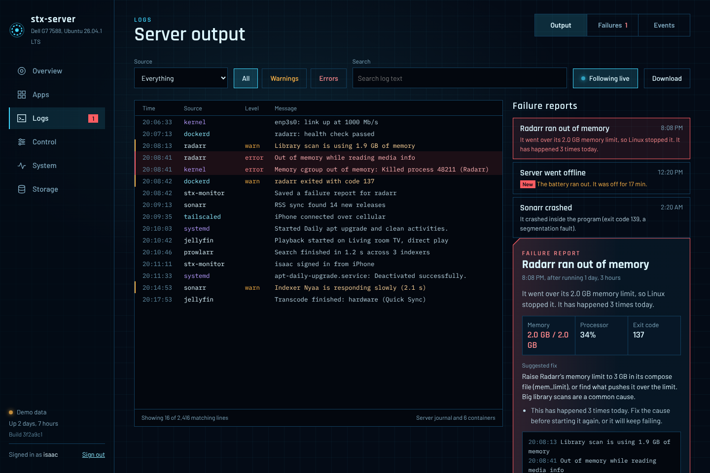
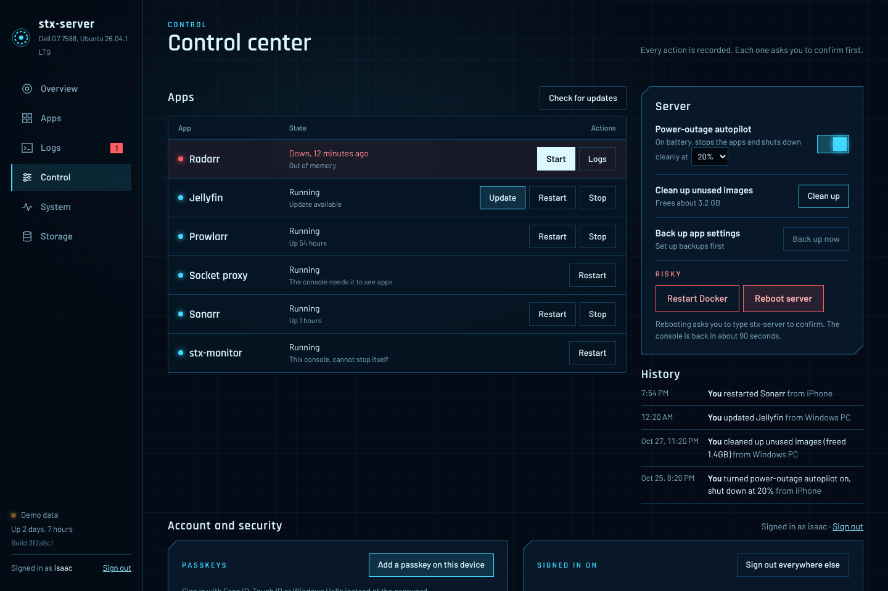
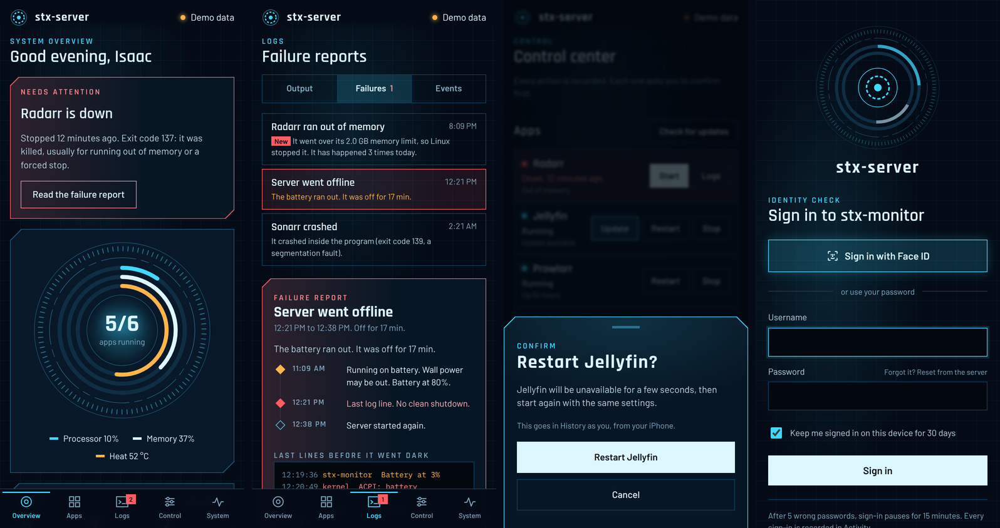

# stx-monitor

The home screen for `stx-server`, my Dell G7 laptop running Ubuntu Server. It shows the
live health of the machine, a map of every app on it (planned ones too), the server's logs,
a failure report whenever something breaks, and a control center to start, stop, update and
reboot, all behind a passkey sign-in that only my Tailscale devices can reach.









*Screenshots use demo mode (`/?demo`, or `/?demo&signin` for the sign-in page), which fills
the UI with made-up data.*

## What it does

- **Overview**: CPU, memory and heat rings around the apps running, an alert when something
  is down, 1-hour sparklines.
- **Apps**: every app from [`config/apps.yaml`](config/apps.yaml) matched to its container;
  planned apps are dashed. Open one for details, logs and actions.
- **Logs**: the server's system journal (this boot and earlier ones) and every container's
  output in one live, searchable stream. **Failures** holds a report for each crash or
  unclean shutdown: exit code, memory and CPU at the time, the last 200 lines, and a
  suggested fix. **Events** is the timeline of starts, stops, power, heat and sign-ins.
- **Control**: start, stop, restart and update apps; clean up images; restart Docker;
  reboot (type the hostname to confirm). Every action asks first and lands in History.
- **Power-outage autopilot**: on battery at 20% (adjustable), it stops the apps and shuts
  the server down cleanly instead of letting the battery die mid-write.
- **System** and **Storage**: per-thread load, processes, battery, lid, GPUs, sensors,
  network, Tailscale devices, and every drive, with setup steps for unformatted ones.

## Set up on stx-server

1. Get the code and start it:

   ```bash
   git clone https://github.com/isaacxj/stx-monitor.git ~/stx-monitor
   ```

   ```bash
   ~/stx-monitor/scripts/deploy.sh
   ```

2. Install the host helper (shutdown, reboot, Docker restart, updates):

   ```bash
   sudo ~/stx-monitor/scripts/install-helper.sh
   ```

3. Set your username and password:

   ```bash
   docker exec -it stx-monitor python -m monitor set-password --username isaac
   ```

4. Publish it to your tailnet over HTTPS:

   ```bash
   sudo tailscale serve --bg 8090
   ```

   Open `https://stx-server.<your-tailnet>.ts.net`, sign in with the password, then go to
   **Control → Add a passkey on this device** on each phone or laptop. From then on it's
   Face ID or Touch ID.

stx-monitor listens on `127.0.0.1:8090` only, so nothing on the LAN or the internet can
reach it; `tailscale serve` is the only way in. If you added ufw rules for port 8090 earlier,
remove them:

```bash
sudo ufw delete allow in on tailscale0 to any port 8090 proto tcp
```

To update later, run `scripts/deploy.sh` again. It tells you when the helper needs
reinstalling.

For autopilot to bring the server back after an outage, set the BIOS to power on when AC
returns (on Dell laptops this is usually *Power Management → AC Behavior → Wake on AC*).

## Server commands

```bash
docker exec -it stx-monitor python -m monitor set-password   # change the password
docker exec stx-monitor python -m monitor status             # user, passkeys, sessions, lockout
docker exec stx-monitor python -m monitor unlock             # end a 15-minute lockout now
docker exec stx-monitor python -m monitor reset-passkeys     # lost a phone
docker exec stx-monitor python -m monitor sign-out-everywhere
```

## Add an app to the map

Add it to [`config/apps.yaml`](config/apps.yaml) (the map reloads within seconds), or label
its container: `stx.app: radarr` to match an app in the file, or `stx.name`, `stx.group` and
`stx.url` for something that isn't in it. Add `stx.protected: "true"` to a container that
must never be stopped or updated from the console.

## How it works

Four pieces, each with as little power as it needs:

| Piece | What it can do |
| --- | --- |
| **stx-monitor** (container) | Reads the host through a read-only mount of `/` at `/host`. Runs as root inside the container, which it needs for the CPU energy counter (RAPL), the host's `/proc/1/net` and running the host's `journalctl` with `chroot`. Listens on localhost only. |
| **stx-docker-proxy** | Read-only Docker API: containers, stats, logs, events, image and disk info. Every POST is refused. |
| **stx-docker-control** | A second proxy that allows only start, stop and restart. It can't create, delete, exec into or even list containers. |
| **stx-helper** (systemd service on the host) | A short list of root jobs: power off, reboot, restart Docker, prune images, pull and recreate one compose service. Nothing else, and only root can open its socket. |

The container never touches `/var/run/docker.sock` and never gets root on the host. It
can't stop itself or either proxy. Everything it keeps (events, failure reports, action
history, sessions, settings, 24-hour charts) lives in one SQLite file, `/data/monitor.db`,
on the `stx-data` volume.

A few Linux ideas it relies on: `/proc` and `/sys` are the kernel's live view of processes,
memory, devices and sensors, exposed as files; the **journal** is systemd's log of every
service, read with `journalctl --directory` (`-b -1` for the previous boot); **cgroups**
meter each container's memory and CPU; and an **unclean shutdown** shows up as a previous
boot whose journal just stops, with no "shutting down" lines at the end.

## Security

- One user. Passkeys (WebAuthn) plus an argon2-hashed password, set only from the server.
- Session cookie: HttpOnly, Secure, SameSite=Strict; 30 days with "keep me signed in",
  12 hours otherwise. The server stores only a hash of it.
- Every request that changes something must come from the console's own page (Origin
  check) and carry the session's CSRF token.
- 5 wrong attempts in a row pause sign-in for 15 minutes. Every sign-in, success or not,
  is recorded and shown in Events and Control.
- Every action asks for confirmation; reboot asks you to type the hostname. All actions,
  including refused ones, are written to History with who did them and from which device.

## Local development

```bash
python3 -m venv .venv && . .venv/bin/activate
pip install -r requirements-dev.txt
pytest
```

```bash
STX_HOST_ROOT=/ DOCKER_HOST=none STX_INSECURE_COOKIE=1 python -m monitor
```

Open `http://localhost:8090` (run `python -m monitor set-password` first), or
`http://localhost:8090/?demo` for fake data without signing in.

Settings come from environment variables: `STX_HOST_ROOT`, `DOCKER_HOST` (or `none`),
`STX_DOCKER_CONTROL_HOST`, `STX_APPS_FILE`, `STX_DATA_DIR`, `STX_BIND` (127.0.0.1),
`STX_PORT` (8090), `STX_POWER_RATE` (0.15 $/kWh), `STX_OWNER`, `STX_PUBLIC_URL`,
`STX_GIT_SHA`, and for development only `STX_AUTH=off` and `STX_INSECURE_COOKIE=1`.

## Roadmap

- ntfy push alerts to my iPhone for failures, power loss and sign-ins.
- Jellyfin now playing, with a hardware vs software transcode badge.
- Sonarr/Radarr download queue and a hardlink check.
- Disk-full forecast from the growth rate.
- SMART disk health.
- Backups with restic, and their age on the overview.
- "Ask AI" diagnosis button on a failure report.
- Deploy panel showing the running commit for each app.
